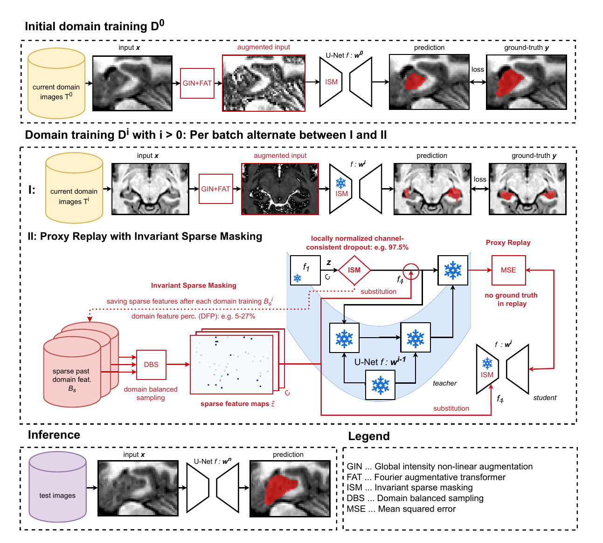

# PRISM: Proxy Replay with Invariant Sparse Masking for Domain-incremental Continual Segmentation



Code for the paper:

> S. J. Joham, M. Kozinski, A. Hadzic, F. Thaler, M. Urschler.
> *PRISM: Proxy Replay with Invariant Sparse Masking for Domain-incremental
> Continual Segmentation.* Medical Image Analysis.

A U-Net (nnU-Net, 2D) is trained on a sequence of domains (sites, scanners,
protocols) one after the other, without keeping past-domain images or labels.
PRISM is a feature replay method: after each domain it keeps a small buffer of
feature maps of the first encoder block and replays them, together with the
current domain's images, in later training steps.

- **Invariant Sparse Masking (ISM).** The stored feature maps are sparsified
  by channel-consistent dropout (CCD: the same spatial mask for every channel,
  e.g. 97.5% of the pixels set to zero) followed by a local normalization of
  the remaining entries. The same masking is applied as an augmentation to the
  current-domain features during training.
- **Proxy replay.** Replayed feature maps are trained with knowledge
  distillation from the previous-domain model (mean squared error between the
  outputs of the two models). No past-domain labels are stored.
- **Plasticity.** The encoder is frozen after the first domain. GIN and FAT
  (Fourier-based) augmentation of the input images keep the rest of the model
  adaptable to new domains; replay batches are balanced across past domains.

In a 5-fold cross-validation across 13 public MRI datasets and three domain
shift scenarios (anatomical variation, differing imaging protocols and
field-of-view changes), PRISM substantially outperforms previous
privacy-protecting methods and shows a small performance gap to methods that
do not protect privacy.

PRISM is the successor of FOCUS (MICCAI 2025, see [Citation](#citation)), whose code is included here.
Both are built on [Lifelong-nnUNet](https://github.com/MECLabTUDA/Lifelong-nnUNet)
and nnU-Net v1.

---

## Installation

```bash
conda create -n prism python=3.9
conda activate prism
git clone https://github.com/imigraz/PRISM.git
cd PRISM
export SKLEARN_ALLOW_DEPRECATED_SKLEARN_PACKAGE_INSTALL=True   # nnU-Net v1 still lists the old 'sklearn' package
python -m pip install -r requirements.txt   # also installs this package in editable mode (-e .)
```

Tested with Python 3.9, CUDA 12.4 and the versions pinned in
`requirements.txt` (PyTorch 2.5.1).

Set the nnU-Net environment variables `nnUNet_raw_data_base`,
`nnUNet_preprocessed`, `RESULTS_FOLDER` and, for the evaluation,
`EVALUATION_FOLDER`, as described in
[documentation/setting_up_paths.md](documentation/setting_up_paths.md).
General information on the framework is in
[README_Lifelong-nnUNet.md](README_Lifelong-nnUNet.md).

## Using your own data

You need one nnU-Net (v1) task per domain, all with the same image modalities
and the same labels:

```
$nnUNet_raw_data_base/nnUNet_raw_data/Task501_SiteA/imagesTr/<case>_0000.nii.gz
$nnUNet_raw_data_base/nnUNet_raw_data/Task501_SiteA/labelsTr/<case>.nii.gz
$nnUNet_raw_data_base/nnUNet_raw_data/Task501_SiteA/dataset.json
$nnUNet_raw_data_base/nnUNet_raw_data/Task502_SiteB/...
```

Preprocess all tasks, then train the sequence in the order given by `-t`
(here SiteA, then SiteB, then SiteC), one call per fold. The example uses the
hippocampus values of the paper:

```bash
nnUNet_plan_and_preprocess -t 501 502 503
nnUNet_train_PRISM 2d -t 501 502 503 -f 0 -num_epoch 100 -save_interval 100 -s seg_outputs --store_csv -d 0 \
    -layer_name conv_blocks_context.<N> -num_samples_in_perc 1.0 -seed 1 \
    -sparsity_aug 0.95 -sparsity_replay 0.975 -DFP 0.05 --dedup_slices --exp_name prism
```

Trained models are written to `$RESULTS_FOLDER/nnUNet_ext/2d/<all tasks joined>/`,
with the model after each domain in its own sub-folder. The replay buffer is
kept in the same folder during training and deleted when training ends.
[Evaluation](#evaluation) evaluates every model of the sequence on the
validation cases of every domain.

### Parameters

- **`-layer_name`**: the encoder is frozen up to and including this layer
  after the first domain. We freeze the whole encoder, i.e. up to the
  bottleneck `conv_blocks_context.<N>`, where `N` is the number of pooling
  operations of the 2D plan of the first task (`num_pool_per_axis` in
  `$nnUNet_preprocessed/<first task>/nnUNetPlansv2.1_plans_2D.pkl`).
  `conv_blocks_context.0` freezes only the first block. Replay always uses the
  feature maps of the first encoder block, whatever this flag is set to.
- **`-sparsity_aug`**: CCD rate of ISM applied as augmentation to the
  current-domain features (a quarter of each batch, after every encoder block
  but the bottleneck).
- **`-sparsity_replay`**: CCD rate of the stored feature maps. Higher values
  store less information about past patients and make the buffer smaller, but
  training becomes unstable at some point (in the paper, 99.8% diverges in the
  hippocampus setting). Start from the paper's values and lower the rate if
  the loss diverges.
- **`-CCD`**: sets both rates to the same value; cannot be combined with the
  two flags above.
- **`-DFP`**: fraction of a domain's training patches kept in the buffer (at
  least 30 per domain).
- **`--dedup_slices`**: at most one patch per image slice in the buffer, so it
  covers more distinct slices (matters most for large fields of view).
- **`--no_KD`**: ablation; trains the replayed features with the segmentation
  loss on stored predictions instead of distillation (the predictions are
  then stored as well).

Values used in the paper (all other flags are the same in every setting, see
the commands below):

| | Hippocampus | Prostate | Spine |
|---|---|---|---|
| `-sparsity_aug` / `-sparsity_replay` | 0.95 / 0.975 | 0.99 / 0.995 | 0.99 / 0.99 |
| `-DFP` | 0.05 | 0.17 | 0.27 |
| `-layer_name` | `conv_blocks_context.3` | `conv_blocks_context.6` | `conv_blocks_context.7` |

## The paper's experiments

| Setting | Domains, in training order | `-t` |
|---|---|---|
| Hippocampus | DecathHip → Dryad → HarP | `97 98 99` |
| Prostate | RUNMC → BMC → I2CVB → UCL → BIDMC → HK | `211 212 213 214 215 216` |
| Spine | Vanderbilt → Zurich → Montreal → UCL | `614 613 612 611` |

The datasets are public but not redistributed here;
[scripts/data_preparation/README.md](scripts/data_preparation/README.md)
gives their terms and the preparation steps.

- **Hippocampus**: [Medical Segmentation Decathlon](http://medicaldecathlon.com)
  Task04_Hippocampus, [Dryad](https://doi.org/10.5061/dryad.gc72v)
  (Kulaga-Yoskovitz et al., 2015) and HarP
  ([EADC-ADNI](http://www.hippocampal-protocol.net) labels on
  [ADNI](https://adni.loni.usc.edu) images). Scripts in
  `scripts/data_preparation/hippocampus/`.
- **Prostate**: the [cross-site prostate data of the DeSAM authors](https://github.com/yifangao112/DeSAM),
  a site split of the [multi-site prostate dataset](https://liuquande.github.io/SAML/).
  Download only, no script.
- **Spine**: [spinal cord grey matter challenge](http://niftyweb.cs.ucl.ac.uk/program.php?p=CHALLENGE).
  Script: `scripts/data_preparation/spine/prepare_spine.py`.

All results are five-fold cross-validations: each fold is trained on
nnU-Net's training split of that fold and evaluated on its validation split.
PRISM, fold 0:

```bash
# Hippocampus
nnUNet_train_PRISM 2d -t 97 98 99 -f 0 -num_epoch 100 -save_interval 100 -s seg_outputs --store_csv -d 0 \
    -layer_name conv_blocks_context.3 -num_samples_in_perc 1.0 -seed 1 \
    -sparsity_aug 0.95 -sparsity_replay 0.975 -DFP 0.05 --dedup_slices --exp_name prism

# Prostate
nnUNet_train_PRISM 2d -t 211 212 213 214 215 216 -f 0 -num_epoch 100 -save_interval 100 -s seg_outputs --store_csv -d 0 \
    -layer_name conv_blocks_context.6 -num_samples_in_perc 1.0 -seed 1 \
    -sparsity_aug 0.99 -sparsity_replay 0.995 -DFP 0.17 --dedup_slices --exp_name prism

# Spine
nnUNet_train_PRISM 2d -t 614 613 612 611 -f 0 -num_epoch 100 -save_interval 100 -s seg_outputs --store_csv -d 0 \
    -layer_name conv_blocks_context.7 -num_samples_in_perc 1.0 -seed 1 \
    -sparsity_aug 0.99 -sparsity_replay 0.99 -DFP 0.27 --dedup_slices --exp_name prism
```

`scripts/experiments/{hippocampus,prostate,spine}.sh` contain these commands
together with the single-domain models, the baselines and the evaluation.

### Baselines

| Method | Command | Paper setting |
|---|---|---|
| Keep all data | `nnUNet_train_rehearsal -samples_in_perc 1.0` | all data of previous domains replayed (flag default: 0.25) |
| Sequential | `nnUNet_train_sequential` | default |
| EWC | `nnUNet_train_ewc` | λ = 0.4 (default) |
| MiB | `nnUNet_train_mib` | α = 0.9, λ = 1 (defaults) |
| TED | `nnUNet_train_TED -ted_lambda <λ>` | λ = 1e-2 hippocampus and prostate, 1e-3 spine |
| GIN | `nnUNet_train_sequential_GIN` | applied with probability 0.5 |
| GIN+FAT | `nnUNet_train_sequential_FIESTA` | each applied with probability 0.25 |
| CauAug | `nnUNet_train_cauaug -cauaug_lambda <λ>` | λ = 1e-1 hippocampus and prostate, 1e-2 spine; CKNet with probability 0.5 |
| FOCUS (Tables 7–9) | `nnUNet_train_FOCUS` | CCD 90% (`-CCD 0.9`, default); GIN applied with probability 0.5 |
| Seq. all data (Table 6) | `nnUNet_train_sequential_all_data` | joint training on all domains; only the final model is meaningful |

FR2Seg ([Xu et al., AAAI 2025](https://ojs.aaai.org/index.php/AAAI/article/view/32953))
is not part of this repository. Its official code was not public when we ran
our experiments, so the results in the paper were produced with a private
copy of the code that the authors kindly sent us. The authors announced the
official implementation at [cschengxu/FR2Seg](https://github.com/cschengxu/FR2Seg).

The FOCUS paper evaluated on a separate test set
(`scripts/data_preparation/create_3_split.py`); this repository evaluates on
the validation split of each fold, as in the PRISM paper.

## Evaluation

After all folds are trained, `nnUNet_evaluate_all` evaluates every fold of
every given task sequence on the validation cases (after each step of the
sequence, on all of its domains) and aggregates the folds:

```bash
nnUNet_evaluate_all -trainers nnUNetTrainerPRISM nnUNetTrainerSequential -t 97 98 99 -t 98 -t 99
```

`-t` is repeated once per task sequence. Single tasks evaluate the
single-domain models (`nnUNet_train_sequential` with `--exp_name seq`), which
are needed for forward transfer (FWT). `-f` selects the folds (default 0 to
4), `-d` the GPU. Results are written to `$EVALUATION_FOLDER`:

- `aggregated_summaries/`: AVG, BWT and FWT (DSC and MASD) per trainer and
  experiment, mean and standard deviation over the folds;
- `nnUNet_ext/2d/`: predictions and per-domain metrics of every fold.

## Code layout

```
nnunet_ext/
  network_architecture/generic_UNet_prism.py   U-Net with ISM, encoder freezing, replay forward pass
  training/network_training/prism/             nnUNetTrainerPRISM: distillation, GIN/FAT, replay iteration
  training/network_training/feature_rehearsal_sparse{,_dm}/
                                               per-domain loop, feature extraction, replay buffer
  training/FeatureRehearsalDatasetDM.py        replay buffer dataset and domain-balanced sampler
  training/feature_selector.py                 patient-stratified buffer selection (--dedup_slices)
  training/feature_io.py                       Blosc2 storage of the buffer
  training/storage_benchmark.py                buffer size report
  run/run_training.py, run/run_evaluation.py   CLI (nnUNet_train_PRISM, nnUNet_evaluate_all)
scripts/
  data_preparation/                            the paper's datasets
  experiments/                                 the paper's commands
```

## Notes

**What the replay buffer contains.** Per retained patch: the sparsified
feature map of the first encoder block and one flag that says whether the
patch contains foreground (used for foreground oversampling of the replay
batches). Neither past-domain labels nor predictions are stored; only the
`--no_KD` ablation also stores the model's prediction of each patch.

**Buffer storage.** The buffer is stored losslessly with
[Blosc2](https://www.blosc.org/) (`.b2nd`, zstd with byte shuffle). After each
domain the training log reports the on-disk size (`b2nd=` for the feature
maps, `buffer_on_disk=` for all buffer files) and a projected size, the gzip
size of the sparse feature maps at the image's floating-point precision
(`gz_sparse_<dtype>_l0=`). The storage numbers in the paper (RSF in Tables 7–9,
Fig. 6, Table S5) are these projections.

**Mixed precision.** The PRISM trainer supports mixed-precision (fp16)
training only.

## Maintenance

This is research code, released to reproduce the paper and to apply PRISM to
new data. It is maintained alongside ongoing PhD research, so maintenance is
sporadic: issues and pull requests are welcome, but replies may take a while,
and fixes, new features or support for newer package versions are not
guaranteed. The versions pinned in `requirements.txt` are the tested ones.

## License

The code is licensed under the [Apache License 2.0](LICENSE). Parts of it are
adapted from other projects, as marked in the source files: nnU-Net and
Lifelong-nnUNet (Apache 2.0), GIN (MIT), FIESTA and TED. The datasets of the
paper are not included and have their own terms.

## Citation

```bibtex
@article{joham2026prism,
  title   = {{PRISM}: Proxy Replay with Invariant Sparse Masking for
             Domain-incremental Continual Segmentation},
  author  = {Joham, Simon Johannes and Kozinski, Mateusz and Hadzic, Arnela and
             Thaler, Franz and Urschler, Martin},
  journal = {Medical Image Analysis},
  note    = {Accepted for publication; year, volume and DOI will be added once published}
}

@inproceedings{joham2025focus,
  title     = {{FOCUS}: Feature Replay with Optimized Channel-Consistent Dropout
               for U-Net Skip-Connections},
  author    = {Joham, Simon Johannes and Thaler, Franz and Hadzic, Arnela and
               Urschler, Martin},
  booktitle = {Medical Image Computing and Computer Assisted Intervention --
               MICCAI 2025},
  pages     = {219--229},
  year      = {2025},
  doi       = {10.1007/978-3-032-05185-1_22}
}
```

## Acknowledgements

This research was funded in whole or in part by the Austrian Science Fund
(FWF) [10.55776/PAT1748423](https://doi.org/10.55776/PAT1748423). The HarP
data were obtained from the Alzheimer's Disease Neuroimaging Initiative
(ADNI); data collection and sharing for ADNI is funded by the National
Institute on Aging (National Institutes of Health Grant U19AG024904). This
work builds on [Lifelong-nnUNet](https://github.com/MECLabTUDA/Lifelong-nnUNet)
and [nnU-Net](https://github.com/MIC-DKFZ/nnUNet).
